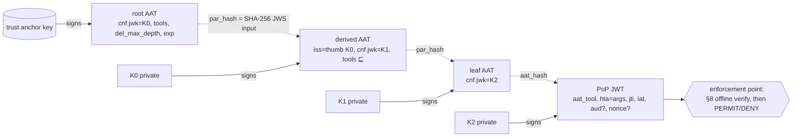
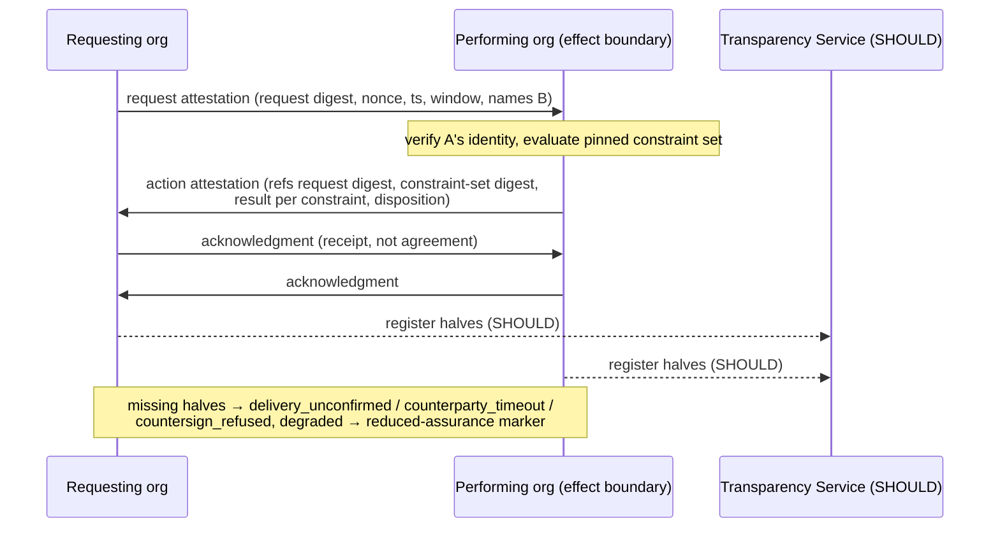
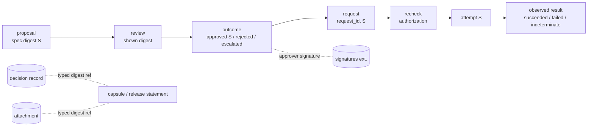
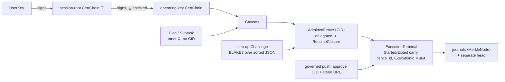
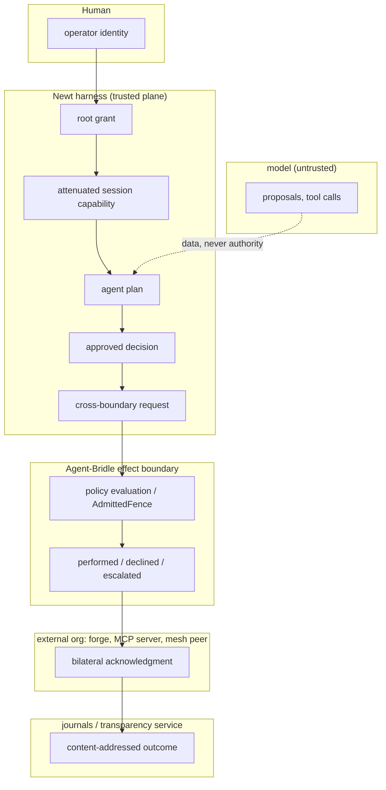

# Authorization and attestation drafts vs Newt's authority and custody chains

**Status:** research spike. Not a design decision, not a roadmap step. It does
not change, delay or add requirements to the v0.8.x release line.
**Date:** 2026-10-30. **Repository base:** `origin/main` at `cb749704f063`.
**Scope:** whether three recent Internet-Drafts can strengthen Newt after
v0.8.0. This sits under two tracks of the operator's post-v0.8 research
program: granular repository authority, and witness/evidence quality.

**Path.** The brief named `docs/research/post-v0.8/`. That is a new subfolder of
the existing `docs/research/`, and it conflicts with no convention.

## 0. Sources and how to read this report

### 0.1 Drafts read (pinned)

| Draft | Revision read | Posted | Intended status | Standing |
|---|---|---|---|---|
| [Attenuating Authorization Tokens for Agentic Delegation Chains](https://datatracker.ietf.org/doc/html/draft-niyikiza-oauth-attenuating-agent-tokens-02) ("AAT") | **-02** (current) | 2026-10-26 | Standards Track | Individual submission |
| [Bilateral Attestation of Cross-Organization Agent Actions](https://datatracker.ietf.org/doc/draft-mih-agent-bilateral-attestation/03/) ("BA") | **-03** (current) | 2026-10-29 | Informational | Individual submission |
| [Decision Provenance for SCITT](https://datatracker.ietf.org/doc/html/draft-lemonnier-scitt-decision-provenance-00) ("DP") | **-00** (current, the only revision) | 2026-10-26 | Informational | Individual submission |

For all three, the datatracker API reported group "Individual Submissions" and no
stream on 2026-10-30. DP's header names "SCITT", but it is not a working-group
document. **None of the three has IETF standing.** Each is work in progress, and
any of them may change incompatibly. AAT -02 already breaks -01 (AAT App. F).
The SCITT documents that BA and DP build on are published: the datatracker
lists RFC 9943 (architecture) and RFC 9942 (COSE Receipts) as Proposed
Standards, checked on 2026-10-30.
The text read was `https://www.ietf.org/archive/id/<name>-<rev>.txt`, with these
SHA-256 values:

```
a7e23c35362c1fb60018a63343f8b0fdc1ce4a8c01fbf73af4a85e7ecf79f0f2  draft-niyikiza-oauth-attenuating-agent-tokens-02.txt
eec088b902d65002c8261c7c4bdb6d0316c7414fdee292f05b6d57c1520aff78  draft-mih-agent-bilateral-attestation-03.txt
61cfd909e031ff7ae94364ca64feb009a5b6ec1a8b65dad8f42282d202c617b0  draft-lemonnier-scitt-decision-provenance-00.txt
```

Two documents carry normative content the drafts delegate, so they were also read:

- **BA** takes its disposition vocabulary from
  [draft-mih-scitt-agent-action-capsule-05](https://datatracker.ietf.org/doc/html/draft-mih-scitt-agent-action-capsule-05)
  ("capsule"). That draft is also an individual submission.
- **DP** defers its formats to the Decision Provenance Standard repository at
  commit `5b0534d`. The action-binding extension 0.3.0 there is
  ([README](https://github.com/decision-provenance-standard/standard/tree/5b0534d/extensions/action-binding))
  is labelled "Proposal. Not part of the Standard." This report calls it
  "DPS-AB".

### 0.2 Newt sources inspected

- Authority and enforcement docs:
  - [`ocap-deviations.md`](../../security/ocap-deviations.md), the live register;
  - [`ocap_confinement_model.md`](../../decisions/ocap_confinement_model.md);
  - [`ocap-enforcement.md`](../../design/ocap-enforcement.md);
  - the three OCAP papers: [authority review](../../ocap/authority-model-design-review.md),
    [caveat lattice](../../ocap/caveat-lattice-paper.md) and
    [permissions facade](../../ocap/permissions-facade-design.md);
  - [`durable_prompt_provenance.md`](../../decisions/durable_prompt_provenance.md).
- The vendored `agent-bridle-core` 0.8.0-rc.6 under
  [`vendor/agent-bridle-core/`](../../../vendor/agent-bridle-core/src/lib.rs),
  from the public [agent-bridle](https://github.com/Gilamonster-Foundation/agent-bridle) project.
- `agent-mesh-protocol` [0.7.1](https://docs.rs/agent-mesh-protocol/0.7.1),
  the version Bridle pins. Lockfile 0.8.1 is identical in the code cited here
  (`diff` of `CertChain::verify_inner` and `sign_payload`).
- Newt's own code:
  - `newt-identity`;
  - `agent-toolchain` `GitCaveats`;
  - from `newt-core`: `fs_cap`, `git_staging`, `event_journal`, `durable_grants`
    and `plan`;
  - the content-addressable rule in [`CLAUDE.md`](../../../CLAUDE.md) and its
    ratchet in [`content_addressable_ratchet.rs`](../../../newt-core/tests/content_addressable_ratchet.rs).
- The [Authority Register](https://github.com/Gilamonster-Foundation/steward-charter/blob/auth-v1.0/docs/AUTHORITY.md)
  (`steward-charter@auth-v1.0`). It is cited as `AUTH-NN` and not re-argued here.

### 0.3 Reading key

Every substantive claim is marked as one of three kinds:

- **Fact:** cited to a draft section or a repository file.
- **Inference:** this report's reasoning from facts.
- **Rec.:** a recommendation.

Figures follow the repository's evidence grades: **measured** (the command and
its output are shown), **derived** or **believed**. Draft text that describes an
implementation, such as AAT App. E's notes on Tenuo, Warden and ARCP, is the
author's claim. Nothing here verifies it.

### 0.4 Normative weight of what is cited

A MUST in an individual draft binds only an implementation that claims that
draft. The table keeps these weights apart.

| Source | Weight |
|---|---|
| AAT -02 §3–§8 | Normative text of an individual Standards-Track draft |
| AAT §4.1 lattice model, App. A–E | Non-normative by the draft's own labels. App. E is author claims |
| BA -03 | Informational individual draft. Its obligations are prose, and its wire encodings are "TBD" (§4, §13) |
| Capsule -05 | Individual Standards-Track draft that BA cites normatively for dispositions |
| DP -00 | Informational individual draft that "adds no rule" of its own (§7) |
| DPS action binding 0.3.0, signatures 0.2.0 | Repository proposals at commit `5b0534d`, "not part of the Standard", with reference tests. An implementation convention |
| RFC 9396, RFC 9942, RFC 9943 | Proposed Standards |
| RFC 9334, RFC 8785 | Informational RFCs |
| in-toto, SLSA, Sigstore, Git object format | Community specifications and implementations |
| Newt and Bridle code | Implementation fact at `origin/main` |

## 1. Executive conclusion

1. **None of the three drafts replaces a Newt mechanism. Each sharpens one seam.**
   Under the program's decision discipline the result is CONFIRMS + REFINES.
   No finding meets the bar for a directional change.
2. **AAT is the closest match, and its algebra is the same shape as Newt's.**
   - Its core constraints (`exact`, `one_of`, `subset`, `range`, `wildcard`,
     `all`/`any`) have decidable, sound and conservative subsumption (§4.5).
     Newt's `Scope = All | Only(set)` lattice is the `wildcard` + `one_of`
     fragment of that algebra.
   - AAT's one property Newt's *identity* delegation lacks is parent-instance
     binding (`par_hash`, I5). This is **measured** in §4.1.8: a mesh `CertChain`
     child still verifies after being re-paired with a different parent cert
     of the same key.
   - Adapt the invariants. Reject JWT/JWS as Newt's internal grant format
     (`AUTH-05`, and the content-addressable rule).
3. **AAT authorizes strings, not objects.**
   - Fact: AAT §3.3.1, §3.4 and §9.1.1 leave resolution to the tool.
   - Measured (§6, CE1): in 8 of 8 alias cases, a textual check accepts the
     value while the resolved object leaves the intended scope. Three of those
     rows use AAT *core* types (`not_one_of` twice, `exact` once).
   - Newt already relies on stronger mechanisms. Keep them as the authority
     designation:
     - object-bound opens (`fs_cap`);
     - the governed push, which has the operator approve the OID and the
       literal URL;
     - Bridle's `relate`, which refuses `Unknown`.
4. **BA -03 is a custody exchange that has no wire format yet** (BA §4 "TBD").
   - Its two parts worth adapting:
     - **constraint-set pinning with per-constraint completeness** (§5);
     - **asymmetry dispositions** (§8), for Newt's *external* boundaries:
       forge, MCP, mesh peers.
   - Inside one Newt process, "bilateral" collapses into self-attestation.
   - It records decisions, not effects. A record can be complete and valid while
     omitting a material side effect (CE4).
5. **DP -00 is a thin pointer layer over the external DPS proposals.**
   - Useful: the DPS-AB *stage chain* (proposal → shown → outcome → request →
     recheck → attempt → result, bound by equal digests), and its rule that
     identity, authority and signature are reported as separate assertions.
   - It does not establish that the approver had authority, and it says so
     itself (DP §3, §10).
6. **The composition fails at the joins, not inside any one draft.** There are
   five digest regimes in play:
   - AAT: SHA-256 over JWS bytes, and JCS for argument comparison;
   - DPS-AB: SHA-256 over exact bytes;
   - BA: "declared, expected JCS";
   - Newt: DAG-CBOR CIDv1/BLAKE3;
   - Bridle step-up: sorted-key JSON + BLAKE3.

   No common identity names "the approved action" across them. Defining that
   join belongs to Newt, through `content-addressable` (§5.3, P0-4).

## 2. Terminology map

**Fact** throughout, except where a cell says "none". In the AAT and BA columns,
"none" means the draft defines no such object.

| Concept | AAT -02 | BA -03 | DP -00 / DPS-AB 0.3.0 | Newt / Bridle today |
|---|---|---|---|---|
| Root authority | trust anchor (issuer URI + key), root token (§2, §6.1) | organizational identity root (§3, §11.7) | verifier's own trust policy (DP §3, §10) | per-user `UserKey` → session-root `CertChain` ([`newt-identity`](../../../newt-identity/src/lib.rs)) |
| Grant value | `authorization_details` (RAR profile, §3.3) | none | approved specification (DPS-AB item 2) | `Caveats` (mesh); `GitCaveats`; `SshCaveats` (no production caller) |
| Attenuated child | derived token (§6.2) | none | none | `AgentKey::delegate` cert; `Subtask.caveats = parent.meet(policy)` ([`plan.rs`](../../../newt-core/src/plan.rs)) |
| Derivation check | I1–I6, §8 step 4 | none | none | `CertChain::verify` (`child ⊑ parent` per link); mesh `check_derivation` (exists, unused by Newt, §4.1.8) |
| Parent binding | `par_hash` = SHA-256(parent JWS signing input) (I5) | none | none | `CertChain`: key only (measured, §4.1.8); mesh `Derivation::Attenuation{parent: GrantId}`: CID |
| Holder / session key | `cnf.jwk`, PoP JWT (§7) | party key | approver / organisation key | mesh agent key; Bridle `SessionId` (step-up) |
| Request | presentation = chain + PoP (`hta` = args) (§7.4) | request attestation (§3) | request stage | `CallRequest{tool,args,resource}`; `PermissionChallenge` |
| Policy evaluated | leaf constraint map | constraint-set snapshot digest + per-constraint results (§5) | "applicable policy version" in spec; recheck stage | `AdmittedFence` (`resolved ⊆ delegated ∪ runtime_closure`); ocap store precedence |
| Human decision | none; approval gates would need a profile (§9.1.2) | `hitl_dispatched`/`escalated` (capsule §5.5.1) | outcome `approved`/`rejected`/`escalated` + approver signature | `OperatorDecision` (`AllowOnce`/`AllowSession`/`Deny`/`ApproveDurable`). Bridle step-up `Attestation` exists but Newt's passkey answer path is "designed but never wired" ([`permission_challenge.rs`](../../../newt-core/src/permission_challenge.rs)) |
| Disposition | PERMIT/DENY (§8) | action attestation disposition (capsule `verdict_class`) | attempt + result `succeeded`/`failed`/`indeterminate` | `ExecutionTerminal::{Exited, Denied, Failed}` |
| Effect evidence | none | via capsule effect record (`effect_mode`, `effect_attestation`) | observed result "with the basis of the observation" | `ExitEvidence{fence, dropped, proxy}` |
| Fence identity | none | constraint-set digest | none | `AdmittedFenceId` (CIDv1, [`admitted.rs`](../../../vendor/agent-bridle-core/src/admitted.rs)) |
| Acknowledgment | none | two acknowledgments (§4) | none | none |
| History | none | Transparency Service registration (SHOULD) | anchoring checkpoints + Receipt (§7) | `MerkleNode` journal + separate head ([`event_journal.rs`](../../../newt-core/src/event_journal.rs)) |
| Revocation | none (§9.8) | inherited from identity layer (§11.8) | key states in trust policy (DPS-AB) | causal generation (`CertChain::verify_at`); file removal (`durable_grants`) |
| Platform attestation | complementary (RATS, §9.3) | orthogonal (§10) | none | none; the Bridle `EnforcementReport` is self-reported |

## 3. Protocol and object diagrams

**AAT (Fact, §4, §7, §8).** Every arrow is a signature. Every dashed arrow is a
digest commitment.



**BA (Fact, §4, §5, §8).** No wire encoding is fixed in -03.



**DPS-AB stage chain (Fact, DPS-AB items 2–6; DP §4).**



**Newt today (Fact, cited files).** The ⟨CID⟩ objects are content-addressed. The
objects without it carry no content identity.



## 4. Per-proposal findings

### 4.1 Attenuating Authorization Tokens (-02)

#### 4.1.1 What is signed at each hop

**Fact (§3.2, §3.5, §4.6, §6.2, §7.2).**

- **Root token.** Signed by the trust anchor's key. It carries `jti`, `iss`
  (the issuer URI), `iat`, `exp`, `cnf.jwk` (the holder key), the optional
  `aud`, `del_depth = 0`, `del_max_depth` and `authorization_details`.
- **Derived token.** Signed by the *parent holder's* key. Its `iss` is the
  JWK-thumbprint URI of that key. It adds `par_hash`, the base64url SHA-256 of
  the parent's JWS Signing Input.
- **PoP JWT.** Signed by the leaf holder over `jti`, `iat`, `aat_id`,
  `aat_hash`, `aat_tool`, `hta` (the exact arguments), and optionally `aat_aud`
  and `nonce`.

**Derived.** `par_hash` covers the parent's signing input, and that input
contains the parent's own `par_hash`. So each token commits transitively to the
exact bytes of every ancestor. The PoP commits to the leaf through `aat_hash`,
and therefore to the whole chain and the exact invocation.

Not covered by any signature:

- the meaning of a tool identifier;
- the resource a constraint value resolves to;
- the enforcement point's configuration. Whether a tool has side effects is
  decided by the enforcement point (§7.3).

#### 4.1.2 Which attenuation relations are checked

**Fact (§4, §8).** I1–I5 are checked algorithmically at every link, and I6
once per presentation, all offline: I1 delegation authority (thumbprint), I2
depth, I3 TTL, I4 capability, I5 `par_hash`, and I6 the leaf holder's PoP.

I4 is structural subsumption over a closed table (§4.5, Table 4). It is
conservative: an `exact` child under a parent `any` is rejected.

Extension types must give a polynomial, sound, deterministic `subsumes` (§5.1).

The draft carries no mechanized proof. It asks implementers to publish analyses
(§9.2). The property-based tests attributed to Tenuo are an author claim
(App. E.1).

**Derived (checked by reading Table 4 against each type's check predicate).**
Every listed (parent, child) pair is sound *over JSON values compared by JCS*:

- `not_one_of`: the child's exclusions are a superset of the parent's;
- `contains`: the child requires a superset of the parent's elements;
- `subset`: the child allows a subset of the parent's elements;
- `all`: each parent clause subsumes some child clause;
- `any`: each child clause is subsumed by some parent clause.

No unsound row was found. That soundness stops at the string; see §4.1.5.

#### 4.1.3 Can constraints express Newt-relevant capabilities?

| Capability | AAT core | What it needs | Newt today (Fact) |
|---|---|---|---|
| One repository, not another | Yes, if the repo is a string argument: `repo: exact "…"`. Closed-world maps reject the rest (§3.3). | The tool must resolve the string to that repository (§9.1.1) | `GitCaveats.remote` is scoped by remote *name*, an alias ([`git_caveats.rs`](../../../agent-toolchain/src/git_caveats.rs)). The governed push approves the *literal* `remote.<name>.url` and the OID ([`git_staging.rs`](../../../newt-core/src/git_staging.rs) header) |
| Selected paths / an authorized projection | Paths: enumeration only (`exact`, `one_of`). Prefix or tree needs an extension type (§3.4). A projection is not expressible at all: constraints restrict arguments, not results (§9.1.2) | A path extension with sound resolved-object semantics; a projection identity (§6, CE5) | `fs_cap` binds to the opened object on Linux (`openat2` RESOLVE_BENEATH) and macOS (held fds + `O_NOFOLLOW`) ([`fs_cap.rs`](../../../newt-core/src/fs_cap.rs)). Register residual: "pathname grants and signatures do not pin an inode" |
| Read / propose-patch / commit / push / merge | Yes, as distinct tool identifiers. Omitting a tool attenuates (§3.6.2) | Ordering ("merge only after review") is not expressible (§9.1.2) | `GitCaveats{read, stage, commit_local, refs, remote, fetch, push, clone}`. No propose-patch or merge verb |
| One named SSH key without `~/.ssh` | As a *designation*: `key: exact "deploy-a"`. The key material must stay with the enforcement point | Delegated execution. A path-valued key argument brings aliasing back | `SshCaveats` (hosts + keys) is inert: the inert-code ratchet lists it as debt X02, "no production caller" ([`inert_code_ratchet.rs`](../../../newt-core/tests/inert_code_ratchet.rs)). The harness-private marker refuses `.ssh` in `RuntimeClosure` ([`admitted.rs`](../../../vendor/agent-bridle-core/src/admitted.rs)) |
| Network destination, protocol, method, bounded payload | Host, scheme and method: `exact`/`one_of`. **Payload size: no.** `range` takes numbers only, and there is no length constraint (Table 2) | An extension, or a numeric size argument computed by the enforcement point | Bridle `NetPolicy` host allow-list + egress proxy; `web_fetch` SSRF screen |
| A tool with structural argument restrictions | Top-level arguments only. Nested values only by whole-value `one_of` | A structured extension type | Name-level leashes (`RemoteTool`) |
| Content-addressed inputs | Yes: `exact` on a digest string. This is the strongest designation, because a CID has no filesystem alias | Exact-string comparison treats multibase variants of one CID as different values. That fails closed for allow-lists and open for `not_one_of` | `content-addressable` CIDs; git OIDs in the governed push |
| Content-addressed outputs | No. AAT authorizes invocations, not results | A receipt layer | `RawContentId`; journal `MerkleNode` |

#### 4.1.4 Which constraint forms compose decidably

**Fact (§3.4, §5.1, App. C).**

- The core is decidable and composable by construction.
- Path, URL, glob, regex and policy-language matchers (Cedar is the draft's
  example) must be registered extensions, each with a decidable, sound,
  deterministic `subsumes`.
- If full containment exceeds polynomial time, the extension must ship a
  conservative syntactic check.

**Background (believed, textbook).** Containment for general regular expressions
is PSPACE-complete. So a regex constraint can only be registered with a
conservative fallback.

**Fact (Newt).** Newt's `Scope<T>` is `All | Only(BTreeSet)` with membership
`permits` ([`caveats.rs`](../../../agent-toolchain/src/caveats.rs)), which is
AAT's `wildcard` + `one_of`. Bridle's resolved lattice classifies every pair five
ways: `Equal`, `Subset`, `Superset`, `Incomparable` and `Unknown`. `Unknown`
refuses ([`provenance.rs`](../../../vendor/agent-bridle-core/src/provenance.rs)).

**Inference.** AAT's boolean `subsumes` has no `Unknown`. A conservative
`false` covers that case for derivation, but nothing in AAT covers it for the
*check* predicate at invocation time.

#### 4.1.5 Where monotonicity breaks

**Fact (§3.3.1, §9.1.1).**

- Tool identifiers are compared as exact strings, and enforcement points MUST
  NOT normalize them.
- Argument normalization belongs to individual constraint types.
- "the tool remains responsible for resolving it to the correct resource."

**Measured.** [`normalization_counterexamples.py`](./normalization_counterexamples.py)
uses the standard library only:

```
$ python3 -I docs/research/post-v0.8/normalization_counterexamples.py
path prefix + '..'                           textual_ok=True  resolved_inside=False
url prefix: forge.example/org/repo-a/../rep  textual_ok=True  resolved_inside=False
url prefix: forge.example/org/repo-a%2F..%2  textual_ok=True  resolved_inside=False
url prefix: forge.example@evil.example/org/  textual_ok=True  resolved_inside=False
url prefix: forge.example.evil.example/org/  textual_ok=True  resolved_inside=False
not_one_of: /srv/cafe\u0301/secret           textual_ok=True  resolved_inside=False
not_one_of: /var/agent/.SSH/id_ed25519       textual_ok=True  resolved_inside=False
exact symlink: repo-a/README -> repo-b/secret textual_ok=True  resolved_inside=False
```

The rows test different things:

- **Rows 1–5** test a *hypothetical* lexical-prefix extension. AAT defines none
  and requires a sound one (§5.1).
- **Rows 6–7** use the core `not_one_of`. The denylist is sound over strings,
  but on a normalization-insensitive or case-insensitive filesystem the excluded
  file is reachable through an alias.
  **Measured** on a default APFS volume under macOS 15: after creating the
  NFC-named `café/secret` and `.ssh/id_ed25519`, the NFD spelling and `.SSH`
  both open them, and Rust's `std::fs::canonicalize` returns the on-disk
  spellings `café/secret` and `.ssh/id_ed25519`. A case-sensitive Linux
  filesystem would not merge the names (believed, not measured here).
- **Row 8** uses the core `exact`. The string never changes, but the object
  behind it does.

Other places where monotonicity can be lost, all **Fact** with AAT's own
mitigations:

- `"*"` admits arguments that a later version of the tool adds (§9.12);
- an omitted optional argument takes the tool's default (§9.12);
- duplicate JSON members are rejected (§8 3b, 6b, 7b);
- inadmissible numbers are rejected (§3.4).

AAT handles the JSON-level aliases well. It leaves the resource-level aliases
alone.

#### 4.1.6 Revocation, freshness, audience, replay, confused deputy, depth, offline

| Property | AAT -02 (Fact) | Inference |
|---|---|---|
| Revocation | None (§9.8). A root status list (`I-D.ietf-oauth-status-list`) is suggested. A parent stays valid after derivation, and there is no re-keying (§9.4) | Offline verification and revocation pull against each other. AAT chooses offline |
| Policy freshness | None. Constraints are frozen at derivation. `MAX_TOKEN_LIFETIME` has a recommended upper bound of 90 days (§4.4) | A stale-policy substitution is invisible (CE3) |
| Audience | `aud` on every token, all checked (§8 6c). `aat_aud` on the PoP. Enforcement-point nonce (§9.5) | Good. Mirrors DPoP |
| Replay | PoP `iat` window (±30 s recommended, §9.9). `jti` tracking MUST for side-effecting tools, decided by the enforcement point (§7.3) | Which tools count as side-effecting is enforcement-point configuration, outside any signature |
| Confused deputy | Designation and authority travel together *if* the agent acts only under the derived token. "AATs make this possible but do not force it" (§1) | An agent holding two tokens picks which one to use. That choice is ambient |
| Delegation depth | `del_max_depth` plus a local `MAX_DELEGATION_DEPTH` ≥ 8 (I2) | Fine |
| Offline verification | Yes for the chain. No for revocation, nonces and `jti` state (§8 preamble) | |
| Model vs harness | The guarantee "holds only while the holder private key is out of the model's reach" (§9.1.1) | This is Newt's harness/model split, and it is load-bearing |

#### 4.1.7 Object capability, or bearer token with capability vocabulary?

**Fact.** It is not a bearer token: the token is useless without the holder key,
and AAT §6.1.3 says "Clients MUST NOT treat the returned token as a bearer
token". It is also not an object capability in the strict sense.

**Inference:** AAT is an SPKI-style holder-of-key authorization certificate,
with three gaps against a strict object-capability model:

1. **Designation is by name.** A constraint names a string, and the tool binds it
   to an object at use time (§9.1.1). An object capability *is* the reference.
2. **Authority is not exclusive.** Derivation is additive (§9.4), and a holder
   may keep and use a broader token (§1).
3. **The root grant's authority is outside the model.** Mapping a requester to
   tool authority is "deployment-specific" (§6.1.3 step 6).

So AAT is OCAP-compatible at the *algebra* layer and name-based at the
*designation* layer. Newt has the same split. The register states it for
pathname grants (`fs-canonical-containment`), and Newt narrows it where an
object-bound primitive exists: `fs_cap`, OIDs.

#### 4.1.8 Against Newt's existing delegation

**Fact.**

- **The `CertChain` link.** Each link in a mesh `CertChain` is signed by the
  parent agent key over `agent_pubkey ‖ serde_json(metadata)`, and
  `verify_inner` checks `child.caveats ⊑ parent.caveats` at every link. The
  parent cert is carried *beside* the signed bytes, not *inside* them
  (agent-mesh-protocol 0.7.1 `agent_key.rs`, `sign_payload`).
- **The mesh authority module.** It already has I5's property:
  `Derivation::Attenuation{parent: GrantId}`, and `check_derivation` recomputes
  the parent CID and never trusts a caller-supplied one (`authority.rs`).
- **Newt does not use that module.** Outside `vendor/` and `docs/`, the only
  match is a Lean spec:

  ```
  $ git grep -c -E "check_derivation|GrantId|AdmittedFenceId|FenceEvidence" -- ":!vendor" ":!docs"
  formal/CaveatLattice/IdentityLaw.lean:1
  ```

**Measured (AAT §9.1.1 "grant-context substitution", reproduced against
`CertChain`).** The probe below is a scratch crate outside this repository,
depending only on `agent-mesh-protocol = "=0.7.1"`, built `--offline`. It is
abridged: `meta` builds an `AgentMetadata`, and `role` reads the parent cert's
`role`. The last three lines are a negative control.

```rust
let user = UserKey::generate();
let parent_a = AgentKey::issue_derived(&user, "lbl", meta("reviewer-session-1", Caveats::top()));
let parent_b = AgentKey::issue_derived(&user, "lbl", meta("deployer-session-2", Caveats::top()));
assert_eq!(parent_a.cert().agent_pubkey, parent_b.cert().agent_pubkey);
let child = parent_a.delegate(meta("leaf", Caveats::top())).unwrap();
println!("original parent role = {}  verify_ok = {}", role(child.cert()), child.cert().verify().is_ok());
let mut swapped = child.cert().clone();
if let Issuer::Agent { parent, .. } = &mut swapped.issuer { **parent = parent_b.cert().clone(); }
println!("swapped  parent role = {}  verify_ok = {}", role(&swapped), swapped.verify().is_ok());
let parent_c = AgentKey::issue(&user, meta("other-key", Caveats::top()));
let mut wrong = child.cert().clone();
if let Issuer::Agent { parent, .. } = &mut wrong.issuer { **parent = parent_c.cert().clone(); }
println!("different-key parent  verify_ok = {}", wrong.verify().is_ok());
```
```
original parent role = reviewer-session-1  verify_ok = true
swapped  parent role = deployer-session-2  verify_ok = true
different-key parent  verify_ok = false
```

The pass is specific to a parent cert of the *same* key. The cause is in
`sign_payload`: the signed bytes are `agent_pubkey ‖ serde_json(metadata)`, and
`verify_inner` relates child to parent only by key equality and `leq`.

**Inference.**

- **Effect.** The swap cannot widen *caveats*, because `child ⊑ substitute
  parent` is still checked. It re-attributes the hop: role, host and expiry
  claims all change.
- **Reachability.** It is reachable only when one agent key holds two certs
  (`issue_derived` with a reused label). `newt-identity` uses random keys
  (`AgentKey::issue`, `delegate`), so Newt's current issuance path does not
  reach it.
- **Rating.** This REFINES the design; it is not a live break. P1-6.

**Fact.** On the interactive path, the mint check is vacuous:

- The facade paper's §7-F2 records that the interactive mint re-roots at
  `AgentKey::issue(user, Caveats::top())`, so `policy ⊑ ⊤` always holds
  ([permissions facade](../../ocap/permissions-facade-design.md)).
- AAT §6.1.3 step 7 has the same shape. It treats the *request* as the parent,
  so a ⊤ request makes the check vacuous.
- **Inference.** In both, a valid signature on a "derived" grant proves nothing
  about narrowness when the parent is ⊤. The ceiling has to come from somewhere
  other than the signature: the preset meet, the operator.

**Fact.** On the TUI path the signature is not load-bearing at all.
`session_capability.rs` mints with `mint_operating_key(p, &policy).ok()` and
falls back to the unsigned `policy` when minting or `enforced_caveats` fails
([`session_capability.rs`](../../../newt-tui/src/session_capability.rs)).
**Inference.** The enforced caveats equal the policy either way, so this is not
a widening. It does mean a signed grant is evidence of the grant only when one
was minted, and nothing records which case occurred.

### 4.2 Bilateral Attestation (-03)

#### 4.2.1 Objects, signers and commitments

| Object | Signer | Contents (Fact, -03) | Commits to (Inference) |
|---|---|---|---|
| Request attestation | requester org | request content digest, nonce, timestamp, validity window, requester identity, named performer (§3) | the request terms. Not any authorization behind them (an optional delegation-receipt reference, §10) |
| Action attestation | performer org | request-attestation digest; constraint-set snapshot digest; a result per constraint (`pass`/`fail`/`not-evaluated` + reason); input-commitment digest (SHOULD); disposition (capsule `verdict_class`) (§3, §5) | the request, *transitively*. The performer's chosen constraint set. Its own disposition claim |
| Refusal | performer org | not a separate object: an action attestation with a decline disposition (§6) | same as above |
| Escalation | performer org | not a separate object: capsule `escalated`/`hitl_dispatched` ("open item", capsule §5.5.1) | an open item. -03 defines no closure object for escalation. Capsule §5.5.4 chains a later resolving Capsule |
| Acknowledgment ×2 | each org | receipt of the counterparty's attestation, "does not assert agreement" (§3) | the counterparty's half. Whether the two acknowledgments commit to each other is unspecified |
| Reduced-assurance indicator | the producing party | a marker in the record, MUST be recorded (§7, §11.3). Registry TBD (§13) | nothing. It is a label |
| Asymmetry dispositions | the surviving party | `delivery_unconfirmed`, `counterparty_timeout`, `countersign_refused`. Orphans are a defined state (§8) | the correlation id + action digest |
| Delivery receipt | intermediary | MUST be registered with a Transparency Service (§9) | delivery only. Payloads are opaque |

**Fact (§4).** "Wire encodings for the four objects are TBD." So the transitive
commitments in the right-hand column are *derived from prose*, not from a format.

#### 4.2.2 What the constraint-set snapshot proves and does not prove

**Fact (§5).** The digest fixes "which constraints — their identities and
parameters — were in force" at evaluation time. Completeness makes an omitted
result a "verifiable omission".

**Inference.** It proves:

- that the performer committed, at signing time, to *a* constraint set;
- that the performer reported a result for each constraint in that set.

It does not prove:

- (a) that the evaluation code applied those constraints. The performer computes
  both the digest and the results;
- (b) that the set was the one the performer was *obligated* to apply. The
  requester never signs it, and no policy authority is bound;
- (c) the inputs, which are only a SHOULD;
- (d) the effect;
- (e) that no other path performed the action.

#### 4.2.3 Does the record separate the six things?

| | Separated? | Where (Fact) |
|---|---|---|
| What was requested | Yes | request attestation |
| What was authorized | **No** | §10 composes an external delegation receipt by reference, optionally |
| What policy was evaluated | Claimed | constraint-set digest + results (§5) |
| What was attempted | **No** in -03 | delegated to the capsule's effect record |
| What effect occurred | **No** in -03 | capsule `effect_mode` / `effect_attestation`. `gate_executed` ranks above `runtime_claimed` and `host_served_observed` (capsule §5.3) |
| What each party acknowledged | Yes | acknowledgments (§4) |

#### 4.2.4 Failure analysis

| Failure | -03 behaviour (Fact) | Verdict (Inference) |
|---|---|---|
| Equivocation (two action attestations for one request) | at-most-one is a MUST (§4) | **Records, if caught.** Nothing prevents a second signature. It surfaces only if both reach one verifier, or the requester's acknowledgment names the other one. See the disagreement below |
| Omission of a side effect | completeness covers constraints, not effects (§5) | **Misses** (CE4) |
| Selective disclosure | commitments are registered; material terms go only to counterparty and auditors (§12). §11.5 concedes the gap for records made outside an exchange | **Records** what is disclosed. Absence is not detectable |
| Precomputation | §11.6: a commitment to a low-entropy value proves nothing about ordering. The requester's signed digest supplies entropy | Holds for *what was requested*. **Misses** for the disposition: a performer can pre-sign both outcomes |
| Replay | nonce, validity window and named performer (§3); mismatch → `denied` (§11.4) | **Prevents** cross-performer replay. At-most-one *attestation* is not at-most-one *execution* |
| Timeout | `counterparty_timeout` (§8) | Records |
| Crash after effect, before signing | Not addressed | **Misses.** The effect happened and no attestation exists. at-most-one forbids a clean retry |
| Partial exchange | orphans; registration deadlines bound the asymmetry (§8, §11.2) | Records |
| Countersignature failure | `countersign_refused`, weaker than a decline (§8) | Records. The distinction is sound |

**Disagreement with BA §11.5.** The draft argues that alternative candidate
attestations each "would have to reference a distinct request attestation", and
so need the counterparty's participation.

That is only true for *acknowledged* candidates. A performer can sign several
action attestations that all cite the *same* genuine request digest. The
at-most-one rule forbids this but does not prevent it. The DPS-AB README admits
the analogous gap for its own attachments: "an older, validly signed attachment
with fewer stages verifies as well."

#### 4.2.5 Can a refusal receipt show that a Bridle boundary worked?

**Fact.**

- BA §6 claims an acknowledged decline is evidence "that its boundary
  enforcement works".
- Bridle's `ExecutionTerminal::Denied` means "No process tree was ever acquired"
  ([`execution/contract.rs`](../../../vendor/agent-bridle-core/src/execution/contract.rs)).
- Newt's denial journal is "evidence only; nothing reads them back into
  authority" ([`denial_journal.rs`](../../../newt-core/src/denial_journal.rs)).
  The chained journal it writes through is "best effort, never load-bearing"
  ([`event_journal.rs`](../../../newt-core/src/event_journal.rs)).

**Inference.** A refusal receipt shows positive evidence of one thing: the
decision path ran and returned deny *for that request*. It is valuable as:

- a regression oracle;
- dispute evidence ("you were answered").

It does not show:

- complete mediation (no other path performed the effect);
- that the fence would have contained the effect had the decision been allow.

Two further limits:

- Because journal writes are best effort, a missing refusal record is not
  evidence that no refused attempt happened.
- "Refusals prove decisions, not confinement." A refusal under a `--yolo`
  session is still a refusal, while the shell runs unconfined
  ([`ocap_confinement_model.md`](../../decisions/ocap_confinement_model.md),
  `AUTH-04`).

#### 4.2.6 Action attestation vs platform attestation

**Fact.** BA §10 calls them "orthogonal layers". AAT §9.3 points to RATS for
issuer and enforcement-point environments.

**Inference.** Two cases show why neither can stand in for the other:

1. **A valid action attestation does not show a confined execution.** It can come
   from an unconfined process.
2. **A valid platform witness does not show an authorized action.** It shows
   *what fence was installed*, and a hostile but in-fence action is consistent
   with it.

Newt has two layers of the "platform" kind:

- `EnforcementReport`/`FenceEvidence`, which are *self-reported* by the harness
  process;
- `AdmittedFenceId`, re-derived at apply time. Newt's own crates never read it
  (`git grep fence_id -- 'newt-core/src/*.rs' 'newt-tui/src/*.rs'` prints
  nothing). It closes in-process admit/apply
  drift (L2), not third-party trust.

**Rec.** Keep the four proofs separate (P0-2).

### 4.3 Decision Provenance for SCITT (-00)

#### 4.3.1 What it adds

**Fact (DP §1, §3).** Provenance, SBOMs and in-toto record *what was built*.
Capsules and receipts record *what was done*, and their human-approval fields are
"the producer's claim". The decision layer adds:

- who decided;
- under which charter;
- the options considered and the rationale, with when the rationale was recorded
  (`contemporaneous` / `later_supplemented` / `not_recorded`);
- a stage chain binding what was *shown* → *approved* → *requested* →
  *attempted*, by equal digests.

**Inference.** The genuinely new claim is the **shown-digest = approved-digest =
attempted-digest chain** with a `request_limit` (DPS-AB items 4–6). The rest is
metadata whose truth stays with the issuer.

#### 4.3.2 What it can bind

All entries are **Fact** from DP §4 and DPS-AB item 2. The specification holds
"the operation, the target, the parameters, the input-version references and the
applicable policy version", and "anything left out of the specification is not
bound".

| Target | Bindable? | Notes |
|---|---|---|
| Source commit or tree identity | Deployer's choice, as an input-version reference | The worked example names the build `2.3.1+git.5d1c9f0`: a short hash inside a version string, not a typed tree digest |
| Patch identity | Deployer's choice | |
| Build plan, locked dependencies | Indirect: via a SLSA provenance digest the verifier holds | |
| Artifact and SBOM digests | Yes. The verifier recomputes them (DP §6 step 4) | |
| Release / deployment environment | As the spec's "target" | |
| Migration and rollback plans | Named in the example | By name, not shown as digests |
| Agent plan and requested effect | Yes: proposal stage (`drafting_authority`) + request stage | |

#### 4.3.3 Identity, role, authority, options, rationale

**Fact (DP §3, §10; DPS-AB "Separate assertions").** DPS-AB reports four
assertions *separately*:

- **human identity:** `actor_ref`, the issuer's statement unless checked against
  an independent source;
- **organisational authority:** verified "only against an independent source,
  such as the permission system";
- **issuer signature:** the organisation seal, which "binds no person" and
  "grants no authority";
- **legal signature:** out of scope.

The approver's signature over the outcome stage is checked with a key that the
*verifier's own* trust policy maps to a person. Options and rationale are "as the
record states them".

#### 4.3.4 Independently verifiable vs issuer claims

| Independently verifiable (Fact) | Issuer claims (Fact) |
|---|---|
| digest equality across stages | who acted; their authority |
| a signature by a key the verifier's own trust policy lists, and that key's state | what the reviewer actually saw or read ("the check shows what the attachment says was shown", DP §3) |
| artifact/SBOM digest agreement, if the verifier holds the artifacts | stage times. Only an RFC 3161 token gives a time bound (DP §3, §10) |
| inclusion of a checkpoint (SCITT Receipt) | that no stage was omitted |
| | that the log only grew. Consistency is "not checked in this version" (DP §4, §7) |

#### 4.3.5 Signer authority at the time

**Fact.** DP does not establish it. The authority reference "stays the issuer's
statement unless the verifier checks it against an independent source" (DP §10).
The verifier can establish key *state* (valid, superseded or compromised), and
for a compromised key only with an earlier independent timestamp (DPS-AB
verifier rules). **So DP shows that someone the verifier trusts signed a digest.**
It does not show that this person was entitled to approve.

#### 4.3.6 Revocation and policy change in historical verification

**Fact.**

- Key revocation follows the anchoring trust-policy key states.
- Policy is carried only as an "applicable policy version" string, plus the
  issuer's own recheck stage.
- Signature stripping is a known hole: "anyone holding a signed attachment can
  remove its signature and present it as unsigned" (DP §10).

**Rec.** A historical verification should report two things independently:

1. consistency against the *cited* policy version, pinned by CID;
2. whether that version has since been superseded or revoked.

It must never silently re-evaluate under current policy. Stored consent must
never override a stronger current policy, which is a property the research
program requires.

### 4.4 Against the comparison targets

| Mechanism | Standing | What it settles | What it does not | Relation to the drafts |
|---|---|---|---|---|
| Macaroons (HMAC caveat chains) | Paper + implementations (informative) | offline attenuation; re-keying makes the parent unrecoverable | needs the root secret to verify; designation is by name | AAT gives up re-keying for public-key verification (§1.3, §9.4). Bridle's `Discharge` borrows the third-party-caveat vocabulary |
| OAuth RAR (RFC 9396) | Standards Track RFC | structured `authorization_details` | attenuation semantics, which a type must define | AAT profiles it (§3.3) |
| in-toto / SLSA | Community specifications (implementation conventions) | "how was this artifact built", by subject digest | who decided; authorization | DP cites them by digest (DP §4) |
| SCITT signed statements + Receipts | RFC 9943 / RFC 9942, Proposed Standards (datatracker, 2026-10-30) | that a statement was registered (inclusion) | time; log consistency; truth of contents (DP §7) | BA SHOULD-registers; DP registers checkpoints |
| RATS (RFC 9334) | Informational RFC | the state of a platform or workload | what that platform did | orthogonal (BA §10, AAT §9.3) |
| Git object ids | Implementation (background, believed) | blob, tree and commit identity by content; a tree id commits to every entry | refs are mutable names. A push is a ref update and is not content-addressed | the governed push pins the OID and literal URL at approval |
| Sigstore / transparency logs | Implementation (background, believed) | inclusion and, with monitors, consistency; short-lived identity-bound signing | authority to sign; completeness of what was logged | the same limits DP §7 states |
| Newt/Bridle | This repo | grant algebra (`Caveats` ⊑, `relate` with `Unknown`); runtime closure (`RuntimeClosure`, harness-disjoint); plan (`Subtask` meet); fence (`AdmittedFenceId`); evidence (`FenceEvidence`, `ExitEvidence`); execution (`ExecutionTerminal`) | durable content identity for plan, decision and execution records; parent-instance binding in `CertChain`; any signed receipt | §5 |

## 5. Composed transaction and trust boundaries



### 5.1 Per arrow: principals, objects, identifiers, anchor

| # | Arrow | Issuer → receiver | Signed object (draft / Newt) | Content identifiers | Applicable policy | Trust anchor |
|---|---|---|---|---|---|---|
| 1 | operator → root grant | operator → harness | AAT root signed by the trust anchor (§6.1.3). Newt session-root `CertChain` signed by `UserKey`. Bridle `HumanPrincipal`/`PrincipalBinding` for OIDC humans | AAT `jti`, allocated. Newt key `Fingerprint`. A mesh `GrantId` exists but is not minted by Newt (§4.1.8) | AAT: issuer policy, out of scope (§6.1.3 step 6). Newt: posture/preset. The mint re-roots at ⊤ (§4.1.8) | AS key / `UserKey` / IdP |
| 2 | root → attenuated session capability | harness → session key | AAT derived token + `par_hash`. Newt `delegate` cert | AAT `par_hash`. Newt: none binds the parent instance (measured) | I4 / `Caveats::leq` per link | root |
| 3 | session → agent plan | model proposes; harness records | none in any draft. Newt `Plan` is unsigned. Plan mode's `PresentedPlan` carries a `RawContentId` over the draft Markdown, held in memory, consumed once on approval, not persisted or signed ([`plan_mode.rs`](../../../newt-core/src/agentic/plan_mode.rs)) | the crew plan has none: `plan.rs` has no `ContentId` (`git grep -c -E "ContentId\|content_id" -- newt-core/src/plan.rs` → no match, exit 1) | `CaveatPolicy` default-deny; subtask = `parent.meet(policy)` | none. Model output is data |
| 4 | plan → approved decision | approver → harness | DPS-AB outcome + approver signature + organisation seal. Bridle step-up `Attestation` over `Challenge(session, action, generation, nonce)`, not yet wired into Newt. `OperatorDecision` pins `PermissionChallenge::digest` | DPS-AB SHA-256 of spec bytes. Bridle `step_up::ContentId` = BLAKE3 over sorted-key JSON, *not* `content-addressable` | DPS charter reference (issuer claim). Bridle `StepUpPolicy`; ocap store deny > passkey > ask > approve | verifier trust policy; operator-signed credential registry ([`credential_registry.rs`](../../../newt-core/src/credential_registry.rs)) |
| 5 | decision → cross-boundary request | harness → boundary | AAT PoP + chain. BA request attestation | `aat_hash`; JCS(`hta`); BA request digest (encoding TBD); DPS-AB request digest | leaf constraint map, closed-world | AAT trust anchor; BA organizational root |
| 6 | request → Bridle evaluation | inside the boundary | BA: none yet. Bridle `AdmittedFence::admit`, unsigned | `AdmittedFenceId` (CIDv1 over mechanism caveats + mechanism). BA constraint-set digest | `resolved ⊆ delegated ∪ runtime_closure`, floor, `Unknown` → refuse | the harness process. No platform attestation |
| 7 | evaluation → disposition | boundary → harness / requester | BA action attestation. Capsule `verdict_class` + `effect_mode`. Bridle `ExecutionTerminal`, unsigned | `FenceEvidence.fence_id`. `ExecutionId` is a `u64` counter, allocated | same | performer key. None locally |
| 8 | disposition → bilateral acknowledgment | each party → the other | two acknowledgments | digest of the counterparty half (TBD) | none: receipt ≠ agreement | organizational roots |
| 9 | acknowledgment → outcome | harness → store / log | SCITT statement + Receipt (optional). Newt chained journal | `MerkleNode` chain + separate head; git OIDs; `RawContentId` | registration policy (DP §7) | log key; the head ref |

### 5.2 Per arrow: freshness, replay, revocation, evidence, what stays unproven

| # | Freshness | Replay boundary | Revocation | Evidence retained | Facts that remain unproven |
|---|---|---|---|---|---|
| 1 | AAT `exp`. Newt causal generation (`verify_at`); `expires_at` is a claim, never checked in `verify_inner` | n/a | AAT none. Newt generation bump | cert / token | that the key holder is the human; that ⊤ was intended |
| 2 | AAT `exp ≤ parent.exp`. Newt generation | n/a | the parent stays valid in both | chain | that string narrowing is object narrowing (CE1); that the key is out of the model's reach |
| 3 | none | none | n/a | prompt receipts and `plan_revision` artifacts, *proposed* (ADR status "Editing") | that the plan is what executes. A plan never grants |
| 4 | DPS-AB recheck before each attempt. Bridle generation + single-use nonce + `SessionId` | DPS-AB `request_id` + `request_limit`. Bridle nonce guard is in memory; the session tag closes cross-lifetime replay | DPS-AB key states | decision record + attachment; Bridle `Attestation` | the approver's authority; what the approver saw; that `CallRequest.resource` was canonicalized ("Resolve before constructing" is a caller contract, [`step_up.rs`](../../../vendor/agent-bridle-core/src/step_up.rs)) |
| 5 | PoP `iat` ±30 s; BA validity window | `jti` tracking, `aud`/`aat_aud`/nonce; BA nonce + named performer | none offline | the presentation | that `hta` is the approved spec. **No draft defines this join** (CE2, §5.3) |
| 6 | per spawn | `ExecutionId` | n/a | `FenceEvidence` in `Started`/`Exited` | native semantic fidelity: "OS access masks, path/symlink interpretation, aliases and deputies still need" native hostile tests ([`admitted.rs`](../../../vendor/agent-bridle-core/src/admitted.rs)). That an honest evaluator ran the pinned set (AAT §9.1.2) |
| 7 | exactly one terminal per stream | at-most-one action attestation, a representation rule | n/a | `ExitEvidence{fence, dropped, proxy}`. `ProxyFinalEvidence` lists *refused* hosts and counts, not *allowed* destinations ([`net_proxy.rs`](../../../vendor/agent-bridle-core/src/net_proxy.rs)) | the external effect; where allowed traffic went (CE4) |
| 8 | window → `counterparty_timeout` | correlation id + action digest | key validity as of registration (BA §11.8) | both halves; orphans | agreement; anything outside the exchange (BA §11.5) |
| 9 | a Receipt states no time; RFC 3161 needed (DP §7, §10) | n/a | supersession | chain + head; Receipt | completeness: tail truncation needs the head (event_journal); log consistency is unchecked (DP §4) |

### 5.3 Semantic gaps concealed by compatible serialization or cryptography

Each line below is **Inference**, built on the facts cited.

1. **A derived grant is not shown to be narrower** by a valid chain.
   - AAT checks narrowness over strings (CE1).
   - The mesh `CertChain` lets a hop be re-attributed (§4.1.8).
   - Both mints are vacuous at ⊤.
2. **The signer is not shown to have institutional authority.**
   - DPS-AB keeps authority a separate, unverified assertion.
   - AAT root issuance is out of scope.
   - BA binds *identity*, never *authority* (§11.1 "Identity Is the Floor").
3. **Enforcement is not shown to have used the attested policy.**
   - BA's performer computes both the digest and the results.
   - AAT assumes an honest enforcement point (§9.1.2).
   - Newt's `AdmittedFenceId` closes this in-process only.
4. **The claimed external effect is not shown to have happened.**
   - Only the capsule grades this (`gate_executed` vs `runtime_claimed`).
   - Bridle sees the process tree, not the remote.
5. **An omitted event is not shown never to have occurred.**
   - Chains detect deletion and reordering, but not tail truncation without a
     head.
   - BA completeness covers constraints only.
   - DPS-AB accepts an older attachment with fewer stages.
6. **An authorized repository projection is not shown to be complete and
   non-leaking.** No draft addresses it (CE5).
7. **The same action has five identities.** These are, in order:
   - AAT: SHA-256 over JWS bytes, and JCS for `hta`;
   - DPS-AB: SHA-256 over "exact bytes";
   - BA: a declared construction, JCS expected;
   - Newt: DAG-CBOR CIDv1/BLAKE3;
   - Bridle step-up: sorted-key JSON/BLAKE3.

   Each is internally sound. Joining them takes a declared transform. Without
   one, a verifier either cannot join them or trusts an unstated mapping.

   **Fact:** BA §11.9 makes the same argument about canonicalization *within*
   one protocol. The ratchet cannot see Bridle's construction, because it counts
   only one literal:

   ```
   $ git grep -n 'line.contains("blake3::hash(")' -- newt-core/tests/content_addressable_ratchet.rs
   newt-core/tests/content_addressable_ratchet.rs:129:    sites_matching(|line| line.contains("blake3::hash("))
   $ git grep -n "Fingerprint::of_bytes\|ContentId::of_bytes(&bytes)" -- vendor/agent-bridle-core/src/step_up.rs
   vendor/agent-bridle-core/src/step_up.rs:26://! ([`agent_mesh_protocol::Fingerprint::of_bytes`]) so the whole stack speaks one
   vendor/agent-bridle-core/src/step_up.rs:76:        Self(Fingerprint::of_bytes(data).0)
   vendor/agent-bridle-core/src/step_up.rs:159:        Self(Fingerprint::of_bytes(&buf).0)
   vendor/agent-bridle-core/src/step_up.rs:229:        ContentId::of_bytes(&bytes)
   vendor/agent-bridle-core/src/step_up.rs:394:        ContentId::of_bytes(&bytes)
   ```

   Lines 229 and 394 hash `serde_json` bytes. The source says "Full RFC 8785
   number/string normalization is a follow-up".

## 6. Adversarial counterexamples

Verdicts: **P** prevents, **D** detects, **R** merely records, **M** misses
entirely.

| CE | Scenario | AAT -02 | BA -03 | DP -00 | Newt today (Fact) |
|---|---|---|---|---|---|
| 1 | A narrower-looking token expands authority through normalization | P for the token algebra; **M** for resolution; **M** for `not_one_of` aliases | R (if inputs committed) | R | `fs_cap` P for Linux/macOS file tools. Governed push P (literal URL + OID). Register: "pathname grants … do not pin an inode" |
| 2 | Decision approves artifact A; B is published | M (no decision concept) | R | D *if* the spec pins the digest, the attempt is honestly recorded, and the verifier hashes what was published; else M | push: P on the brokered path ("nothing resolves a ref after approval"). The register keeps OPEN a bypass by an opaque descendant with unrestricted network |
| 3 | Signed request evaluated under a stale or substituted policy | M | R (pins the stale digest faithfully) | R (the issuer's recheck) | `durable_grants`: "Signatures and encryption do not prevent restoration of an older valid ciphertext" → M |
| 4 | A valid bilateral record omits a material side effect | M | M | M | M: `ExitEvidence` has no downstream effects and no allowed destinations |
| 5 | A projection leaks a hidden object's existence or identity | M; the denylist form *leaks* | M | M | partial: the push broker drops raw diagnostics |
| 6 | Equivocation: two valid action attestations | n/a | R, if both surface | R (the "older attachment" case) | the journal chain covers one log only |
| 7 | Grant-context substitution | P (I5) | n/a | n/a | `CertChain`: M (measured); mesh `Grant`: P (CID parent) |

**CE1: path or URL normalization.**

- **Setup.** The parent token allows `path: one_of ["/w/repo-a/README"]`. The
  child narrows it to `exact "/w/repo-a/README"`. Between derivation and use,
  `README` is replaced by a symlink to `../repo-b/secret`. A second variant: a
  sound-looking denylist `not_one_of ["…/.ssh/id_ed25519"]` admits `…/.SSH/…`.
- **Measured.** §4.1.5 rows 6–8.
- **Why AAT misses it.** Every check is over strings (§9.1.1).
- **What helps.** Binding designation to an object (`openat2` beneath a held
  root; content addresses). A signature does not help. Newt's register already
  says "signatures alone cannot recover the prior intended object".

**CE2: decision for A, publication of B.**

- **Setup.** The approved spec names `release v2.3.1`, which is a tag. After
  approval the tag moves to B, and the deploy job resolves it.
- **Why the drafts don't stop it.**
  - DPS-AB binds the *spec bytes*, and those bytes name a mutable reference.
    "Anything left out of the specification is not bound."
  - AAT's `hta` would carry the same tag string.
  - BA's request digest covers the same terms.
- **Newt.** The governed push avoids this. Its approval object is the OID plus
  the literal URL, and it pushes `<approved-oid>:refs/heads/<branch>` from a
  staging repo ([`git_staging.rs`](../../../newt-core/src/git_staging.rs)).
- **Residual (Fact, register "Known issues (governed push)").** "an opaque
  descendant with unrestricted network can bypass the broker". The prevention
  holds only on the brokered path.
- **Not verified here.** Whether that approval is persisted as a
  content-addressed record.

**CE3: stale or substituted policy.**

- **Setup.** The performer evaluates under snapshot P1, which lacks a constraint
  added in P2, and pins `digest(P1)` honestly.
- **BA** records it faithfully. Only a verifier holding an independent,
  append-only policy-version log, with the head as of registration time, can
  tell.
- **AAT** has no policy freshness. Mission Offline Attenuation, a companion
  profile (AAT §1.3), re-checks Mission state; -02 itself does not.
- **Newt** concedes the rollback case in source
  ([`durable_grants.rs`](../../../newt-core/src/durable_grants.rs)).
- **Rec.** Pin the policy set by CID in a chain with a separate head (`AUTH-08`,
  P1-7).

**CE4: an internally valid record that omits a side effect.**

- **Setup.** The performer executes `git push`, and every pinned constraint
  passes. The remote's CI workflow then deploys.
- **What each record shows.**
  - BA: `executed`, results complete, both acknowledgments valid.
  - Capsule: one request/response digest.
  - Bridle: `Exited{code: 0}`, with a `ProxyFinalEvidence` count of accepted
    connections that names no destination.
- **Inference.** Completeness is relative to what the record *chooses* to
  enumerate. An effect outside the observation boundary needs a witness at the
  downstream boundary. Grade it `runtime_claimed` until one exists (P1-8).

**CE5: a projection leaks a hidden object.**

- **Setup.** The agent is authorized to read a projection of a repository that
  excludes `secret/`.
- **Leak channels** (Inference unless marked):
  - (a) The projection exposes source commit or tree ids so outcomes can be bound
    to source identity, which is exactly what a decision record wants. A tree id
    commits to every entry (background). The agent can detect when hidden content
    changes.
  - (b) A digest of low-entropy hidden content is a confirmation oracle. Fact:
    BA §11.6 states this property for predictable values.
  - (c) Proposing a patch that collides with a hidden path makes a conflict or
    refusal reveal it. Fact: the register says the governed push's raw git/gh diagnostics are
    "captured and dropped entirely" ([register](../../security/ocap-deviations.md),
    "Known issues (governed push)").
  - (d) An AAT `not_one_of` that hides paths puts the hidden names *into the
    token*. Fact: AAT §10, "an AAT chain can reveal … argument constraints".
  - (e) Registering a decision record publishes digests of hidden artifacts
    (BA §12 recommends commitments instead).
- **Verdict.** All three drafts miss it.
- **Rec.** Give a projection its own identity, distinct from the source, and
  express hidden parts only as salted commitments (P1-11).

**CE6: equivocation.** See §4.2.4 and the disagreement with BA §11.5.

**CE7: grant-context substitution.** Measured in §4.1.8.

## 7. Gap and threat table

| ID | Gap / threat | Where it lives | Drafts | Newt today | Grade | Decision it changes |
|---|---|---|---|---|---|---|
| G1 | String designation ≠ object designation | grant → request | AAT M | object-bound for file tools and push; pathname grants elsewhere | measured (script) | grant designation form (P0-1) |
| G2 | Parent-instance binding in identity delegation | `CertChain` | AAT P (I5) | missing; present in mesh `Grant` | measured (probe) | converge delegation onto `GrantId` (P1-6) |
| G3 | Policy snapshot freshness and rollback | evaluation | AAT M; BA R; DP R | rollback conceded in source | fact (source) | policy CID + head (P1-7) |
| G4 | External effect evidence | disposition → outcome | capsule grades only | process tree only; allowed egress unrecorded | fact (source) | effect grading (P1-8) |
| G5 | Five digest regimes for one action | every join | each declares its own | Bridle step-up off-crate; mesh `sign_payload` is `serde_json` | measured (grep) | canonical join (P0-4, P1-9) |
| G6 | Shown ≠ approved ≠ executed | decision → request | DPS-AB D (if honest) | push binds OID+URL; other approvals bind `CallRequest`, whose `resource` is unenforced canonicalization | fact | approval stage chain (P1-10) |
| G7 | Projection leakage | read / propose | all M | partial (diagnostics dropped) | inference | projection identity (P1-11) |
| G8 | Refusal ≠ confinement; best-effort refusal records | disposition | BA overclaims (§6) | denial journal best-effort | fact | never cite a refusal as containment evidence (P0-2) |
| G9 | Equivocation or omission outside the exchange | acknowledgment / log | BA R; DP R | one journal, one head | inference | chain heads to a transparency log (P2-14) |
| G10 | Enforcement-point integrity | evaluation | all assume honest | self-reported `EnforcementReport` | inference | platform attestation (P2-15) |
| G11 | Holder key reachable by the model | session | AAT voids its guarantees (§9.1.1) | the credential stays out of the box (`b1-os-isolation` GATED; `local-deputy-egress` OPEN) | fact (register) | keep harness-held keys (P0-3) |

## 8. Adopt / Adapt / Reject / Watch

| Item | Verdict | Why (cited) |
|---|---|---|
| AAT I5 parent-instance binding | **Adapt** | It closes CE7. The mesh `Grant` already has it; converge on that, don't copy `par_hash` |
| AAT closed-world argument maps, required-by-default, `"*"` discouraged for side effects, explicit optional defaults (§3.3, §9.12) | **Adapt** | For per-argument MCP/remote-tool grants, where Newt today leashes by name only |
| AAT JSON hygiene: reject duplicate members, admissible numbers only (§3.4, §8) | **Adopt** as rules | Applies wherever Newt canonicalizes JSON arguments (Bridle step-up) |
| AAT JWS/JWT as Newt's internal grant format | **Reject** | A second encoding and vocabulary (`AUTH-05`, the content-addressable rule). Revisit only as an *export* format at an MCP boundary whose counterparty requires it |
| String-prefix, glob or denylist path/URL constraints as authority | **Reject** | CE1 (measured). Newt's `relate` + `Unknown` → refuse is stronger |
| BA constraint-set pinning + per-constraint completeness (§5) | **Adapt** | For Bridle admission records; closes the "favourable results only" case |
| BA asymmetry dispositions + "degradation MUST be recorded" (§7, §8) | **Adapt** | For forge/MCP/mesh boundaries that cannot countersign; matches `AUTH-01`/`AUTH-10` |
| BA as a whole inside one Newt process | **Reject** | One principal on both sides is self-attestation |
| Capsule `effect_attestation` grades | **Adapt** | Separates gate-observed from runtime-claimed effects (CE4) |
| DPS-AB stage chain, `request_limit`, recheck-before-attempt, separate assertions | **Adapt** | Maps onto `PermissionChallenge` → `OperatorDecision` → step-up → execution |
| DP typed digest references (§5) | **Watch** | Carry foreign references as `ClassifiedCid`, never re-minted |
| Registering decision records themselves in a public log | **Reject for now** | Privacy (BA §12) and CE5. Register chain heads instead (P2-14) |
| TOFU key acceptance | **Reject** | BA §11.7 calls it non-conformant too |
| A SCITT Receipt as time or append-only evidence | **Reject** | DP §7 says it is neither |
| All three drafts, the AAT revocation companion, Mission Offline Attenuation, BA wire encodings | **Watch** | Individual drafts; incompatible revisions likely |

## 9. Minimal post-v0.8.0 experiment

**A receipt chain for `read_object`**, as a disposable verifier harness with
test vectors.

**Constraints.**

- It is not a framework, and nothing in v0.8.x changes.
- It lives in a throwaway crate outside the workspace, or on a never-merged
  branch.
- It uses only crates already in `Cargo.lock`: `content-addressable` `=0.1.3`,
  `agent-mesh-protocol`, and `agent-bridle-core` with its existing
  `verifier-ed25519` feature.
- The keepable output is the vectors and a verdict table, not the code.

**Why reading a named object.** The object is designated by its git blob OID, so
the outcome *verifies itself*: the returned bytes must hash to the requested OID.
This is the one case where "the claimed effect occurred" can be checked offline.
The "propose a patch" variant does the same with `{base tree, patch CID,
resulting tree}`, re-applied offline. It must not push.

**Steps.** Each object is minted through `content-addressable`; no new encoding.

1. **Root grant R.** A mesh `Grant{Root}` over `Authority{caveats}`, plus a
   session-root `CertChain` signed by a test operator key. The `GrantId` is the
   identity proof; the cert signature is the assertion proof.
2. **Child grant G.** `Derivation::Attenuation{parent: GrantId(R)}`, with
   `fs_read` narrowed to the repository root. `check_derivation` must return
   `Valid`.
3. **Action A.** `{tool: "repo.read_object", repo: <repo identity>, object:
   <blob OID>, grant: GrantId(G)}`, as a `ContentId`.
4. **Decision D.** A step-up `Attestation` over
   `Challenge(session, ContentId(A), generation, nonce)`, signed by a test
   passkey key.
5. **Policy P.** The `ContentId` of `{delegated caveats, RuntimeClosure,
   StepUpPolicy rules}`, appended to a policy chain with a separate head.
6. **Effect boundary.** Read through `fs_cap`, or `git cat-file` under the fence.
   - performed → outcome `O = RawContentId(bytes)`, and the git hash of the bytes
     equals the OID;
   - declined → `Denial`, for a grant that lacks the object.
7. **Receipt E.** A `MerkleNode` whose payload is `{A, G, D, P, disposition,
   O | denial}` and whose parent is the previous head. The head is stored apart.
8. **Offline verifier.** Inputs: the bytes, the operator public key, and the
   object store. No network. It recomputes every CID, verifies the cert chain and
   `check_derivation`, verifies D over the recomputed challenge, and checks P
   against the cited policy head. It checks O against A's OID, or the denial's
   axis, and checks the chain against the head. Every dimension is reported
   separately, never merged (the DP §6 step 5 discipline).

**Negative vectors** (each must be rejected for the stated reason):

| Vector | Expected verdict |
|---|---|
| child widens `fs_read` | `AttenuationWidens` |
| child re-paired with another parent (CE7) | `ParentMismatch` |
| D signed over A′ ≠ A | challenge mismatch |
| outcome bytes for another OID (CE2) | outcome ≠ A.object |
| P′ not at the cited policy head (CE3) | stale policy |
| tampered O | CID mismatch |
| tail-truncated journal | `ChainBreak::Truncated` |
| path-designated variant of A with a symlink swap (CE1) | **verifier passes**. This vector *documents* the gap: designation by OID closes it, designation by path does not |

**Success.** Every positive vector verifies offline. Every negative vector is
rejected for the stated reason. The CE1 path variant is recorded as a known pass.

**What it will not show:**

- that the operator is the human;
- that Bridle enforced anything (there is no platform witness);
- any external effect (a local read has none);
- performance.

## 10. Open questions requiring design decisions

1. **Canonical repository designation.** Which form do grants use: a path
   beneath a held root, a git OID, or a projected-tree CID? This drives CE1 and
   CE5.
2. **Identity delegation.** Should it converge onto mesh `Grant` derivation
   edges (`GrantId` parent), or bind a parent-cert CID into the `CertChain`
   signed payload? Either fixes CE7; only the first gives one vocabulary
   (`AUTH-05`).
3. **Where policy freshness lives.** Per-gate live evaluation, a pinned
   policy-set CID with a head, or both? How does a stored approval yield to a
   stronger current policy?
4. **One receipt vocabulary.** The candidates are Bridle `ExecutionTerminal` +
   `DenialKind`, capsule `verdict_class`/`effect_mode`, and DPS-AB outcomes.
   Which is canonical, and which are export mappings?
5. **Who countersigns at Newt's external boundaries?** GitHub and typical MCP
   servers do not. Is unilateral-with-reduced-assurance the permanent default,
   or does a staging broker act as a witness?
6. **Foreign digests.** May they be carried only as `ClassifiedCid` and never
   re-minted? Do signature preimages (Bridle's length-delimited, domain-tagged
   operator payloads) count as "canonical encodings" for the ratchet, or as a
   named exemption?
7. **Transparency.** Register journal chain heads only? With which log, and
   which consistency evidence (DP §4 says checkpoints alone are not
   append-only evidence)?
8. **Enforcement-point attestation.** What would a RATS-style statement about
   Bridle attest: binary digest, `AdmittedFenceId`, kernel features? Who
   appraises it?
9. **Bridle's harness-private marker check.** `entry_reaches_harness_private`
   is a case-sensitive path-component match (`.ssh`, `.newt`, …) in
   [`admitted.rs`](../../../vendor/agent-bridle-core/src/admitted.rs). Fact:
   the runtime closure is declared only for trusted-worker spawns, never for
   model-selected ones (`trusted_worker_closure` in
   [`spawn.rs`](../../../vendor/agent-bridle-core/src/spawn.rs)). The Seatbelt
   arm canonicalizes the program first, and on APFS that yields the on-disk
   `.ssh` (measured, §4.1.5), so a `.SSH` alias is caught there. The public
   `RuntimeClosure::with_exec` says "Canonicalized by the caller" and does not
   enforce it. Should the type accept only a canonical path, so that an
   uncanonicalized alias cannot be represented?

## 11. Decisions and experiments (prioritized)

**P0: preserve now, with no change to v0.8.x.**

1. **P0-1.** Keep authority designation object-bound: held roots, OIDs/CIDs,
   literal URL + OID for the push. Never accept string-prefix, glob or denylist
   matchers as authority. Any path/URL constraint is checked against the
   *resolved* object, with `Unknown` → refuse.
2. **P0-2.** Keep the four proofs separate: identity (CID), assertion
   (signature), authorization (algebra), enforcement (witness). Intent never
   grants. A signed decision, a refusal receipt and a platform witness never
   stand in for one another.
3. **P0-3.** Keep holder keys and credentials harness-held and out of the
   model's reach. Delegated execution stays the pattern, because AAT §9.1.1
   shows the guarantees vanish otherwise.
4. **P0-4.** Add no new canonical encoding at the joins. Future receipt,
   decision and policy identities are minted via `content-addressable`. Foreign
   digests are carried, never re-minted.

**P1: first post-v0.8.0 research and prototypes.**

5. **P1-5.** Run the §9 experiment and keep its vectors.
6. **P1-6.** Take CE7 upstream to `agent-mesh-protocol`: add the probe as a
   regression test, then decide question 2.
7. **P1-7.** Policy-set CID + per-rule completeness in Bridle admission records,
   chained with a separate head (CE3).
8. **P1-8.** Effect grading in execution receipts (gate-observed vs
   runtime-claimed). Record *allowed* egress destinations in
   `ProxyFinalEvidence`, which today records only refused ones (CE4).
9. **P1-9.** Put Bridle step-up `CallRequest`/`Attestation` identities and mesh
   `sign_payload` under a declared canonicalization. Widen the ratchet predicate
   beyond the `blake3::hash(` literal (G5). Upstream issue.
10. **P1-10.** A stage chain for approvals (shown → approved → requested →
    rechecked → attempted → result) over `PermissionChallenge`,
    `OperatorDecision` and step-up. Verify that every approval binds the digest
    the operator was *shown* (G6).
11. **P1-11.** Projection identity: a projected tree gets its own CID, and hidden
    content appears only as salted commitments. Seed the CE5 cases into the
    adversarial corpus.

**P2: standards monitoring and longer-term exploration.**

12. **P2-12.** Watch AAT: adoption, path/URL extension registrations, the
    revocation companion, Mission Offline Attenuation. Consider an export profile
    only if an MCP counterparty requires AAT.
13. **P2-13.** Watch BA wire encodings and capsule revisions. Prototype only at a
    boundary whose counterparty can countersign.
14. **P2-14.** Register journal chain *heads* (not records) in a transparency
    log with consistency proofs, for third-party omission detection (G9).
15. **P2-15.** Explore platform attestation of the enforcement point (G10).
    Tie it to the hardware-provenance research track.

---

Model: Claude Opus 5.5 | Harness: Claude Code | Operator: Shawn Hartsock | Time: 06:35 PDT | Date: 2026-10-30
